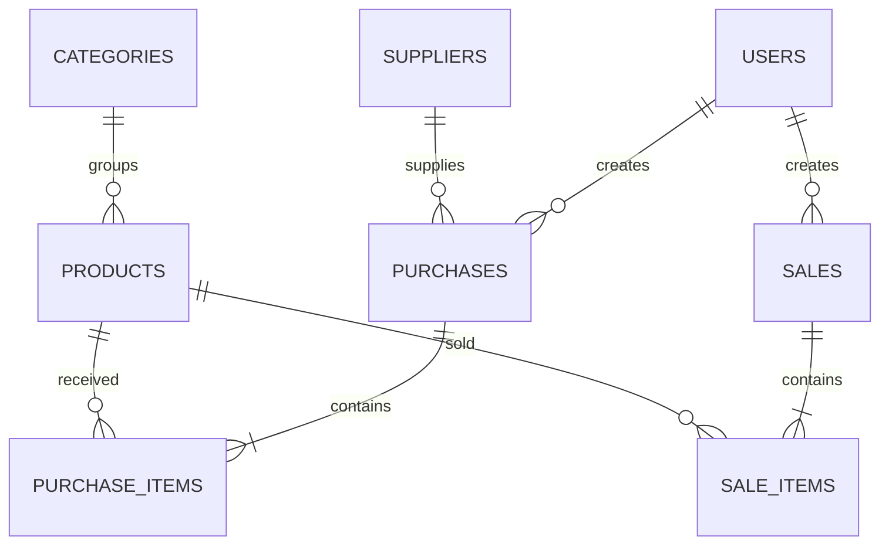

# ERD — Adara Snack

## Ringkasan tabel
- `users`: id, name, email (unik), password hash, role.
- `categories`: id, name (unik).
- `products`: category_id (FK), sku (unik), name, purchase_price, selling_price, stock, minimum_stock.
- `suppliers`: name, phone, email.
- `purchases`: supplier_id (FK), user_id (FK), purchase_number (unik), total, status, purchased_at.
- `purchase_items`: purchase_id (FK), product_id (FK), quantity, unit_cost, subtotal.
- `sales`: user_id (FK), sale_number (unik), total, status, sold_at.
- `sale_items`: sale_id (FK), product_id (FK), quantity, unit_price, subtotal.

## Kenapa tabel item terpisah?
Satu transaksi bisa berisi beberapa produk. Tabel header menyimpan informasi umum transaksi, sedangkan tabel item menyimpan produk, kuantitas, harga saat transaksi, dan subtotal. `hasMany()` dipakai oleh header untuk memiliki banyak item; `belongsTo()` dipakai item untuk menunjuk satu header/produk melalui foreign key.
